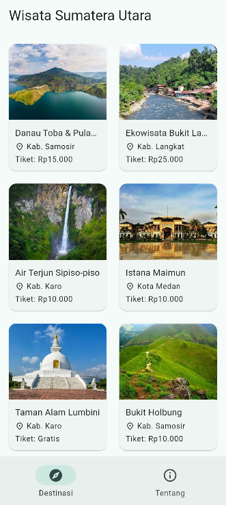
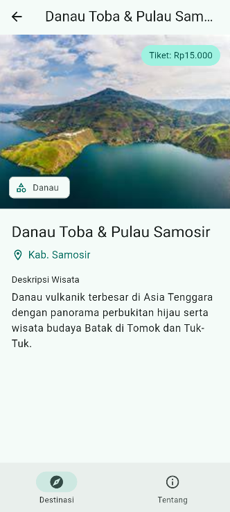
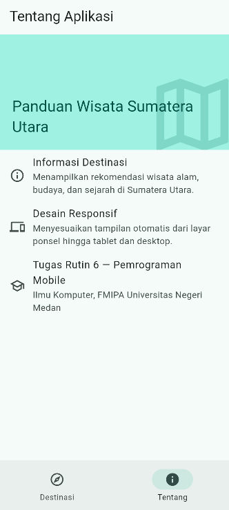
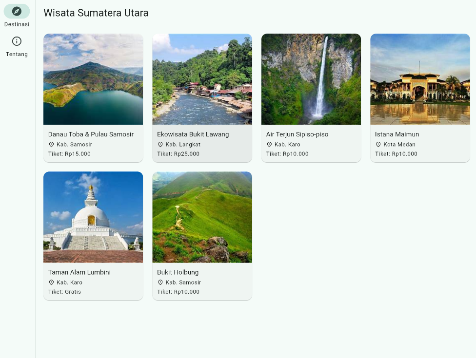
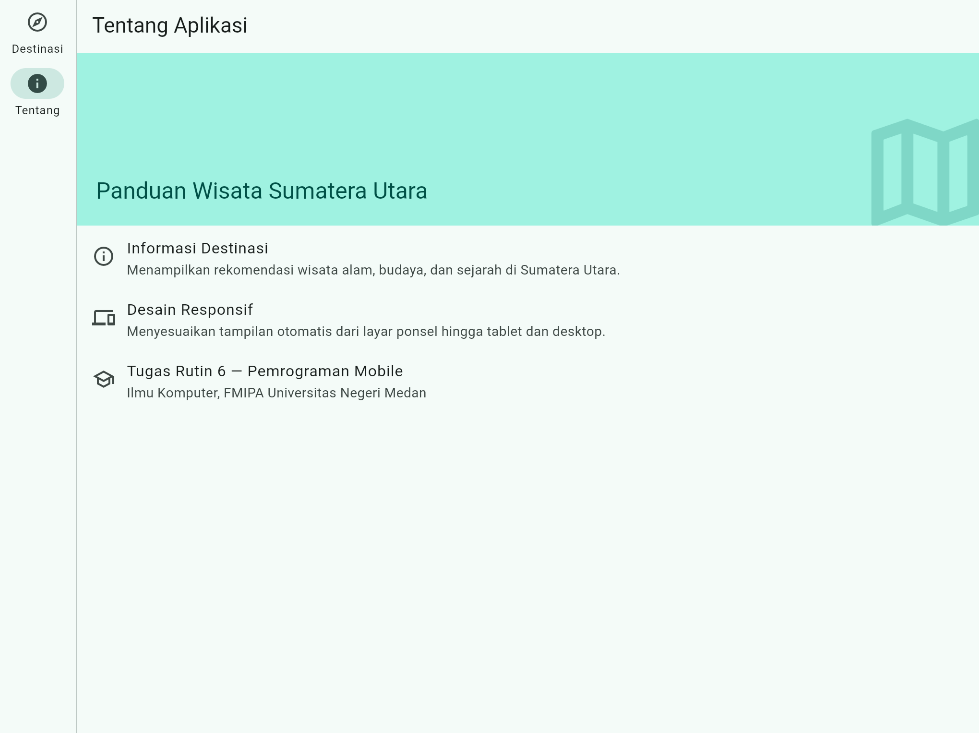

# Tugas Rutin 6 — Aplikasi Wisata Sumatera Utara (Responsif & Multi-Screen)

- Nama  :   Angelina S. Saragih
- NIM   :   4243250049
- Kelas :   PSIK 24C

## Tangkapan Layar Aplikasi

- Tampilan Ponsel

- Tampilan Tablet

## Penjelasan Keputusan Desain Responsif
Pada aplikasi ini, pengaturan tata letak responsif dibagi menjadi dua tingkat dengan memanfaatkan `MediaQuery` dan `LayoutBuilder` sesuai cakupan ruang masing-masing. `MediaQuery.sizeOf(context).width` dipakai pada widget `KerangkaNavigasi` karena keputusan perpindahan antara `NavigationBar` di bagian bawah layar dan `NavigationRail` di sisi kiri berlaku untuk keseluruhan kerangka aplikasi. Batas lebar yang digunakan adalah `840 dp` mengikuti rekomendasi Material Design 3 untuk membedakan layar ponsel atau tablet potret dengan layar lebar.

Sementara itu, `LayoutBuilder` dipilih untuk komponen lokal di dalam halaman karena widget tersebut hanya perlu mengetahui batasan lebar yang diberikan oleh induknya (*parent constraints*). Pada `HalamanWisata`, `LayoutBuilder` membagi grid destinasi menjadi 2 kolom untuk lebar di bawah `600 dp` (ponsel), 3 kolom untuk `600–899 dp` (tablet), dan 4 kolom untuk `900 dp` ke atas. Pada `HalamanDetail`, `LayoutBuilder` memakai batas `700 dp` agar tampilan berubah dari susunan vertikal (`ListView`) pada layar sempit menjadi susunan berdampingan (`Row`) saat ruang cukup lebar. Penggunaan `Expanded` dan `TextOverflow.ellipsis` juga menjaga teks panjang tetap rapi tanpa *overflow*.

## Pernyataan Penggunaan AI
Saya menggunakan AI sebagai referensi awal untuk contoh susunan navigasi dengan `go_router`, penerapan tata letak responsif menggunakan `LayoutBuilder` dan `MediaQuery`, pemanggilan aset gambar lokal, penulisan kode pengujian di `widget_test.dart`, serta diskusi saat memperbaiki error pada `pubspec.yaml` dan penggunaan *Device Toolbar* di Chrome. Untuk pemilihan 6 destinasi wisata Sumatera Utara beserta aset gambarnya, penyesuaian kode, pengecekan lewat `flutter analyze` dan `flutter test`, hingga pengambilan keempat tangkapan layar semuanya saya kerjakan dan uji sendiri.